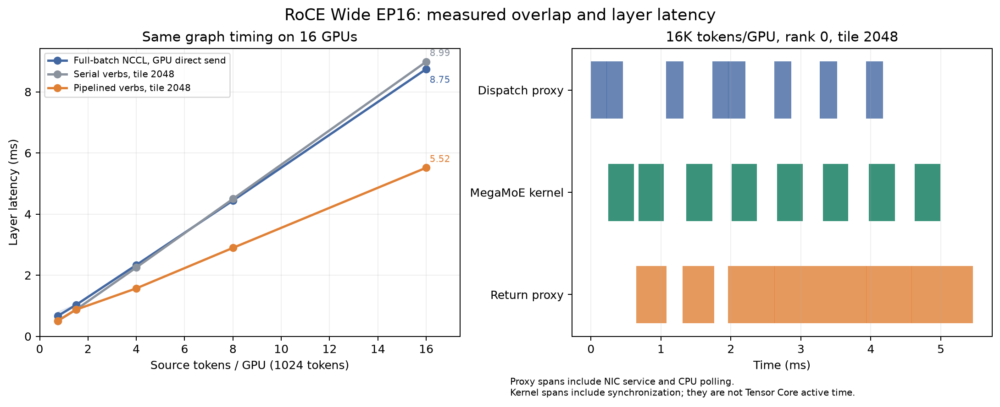
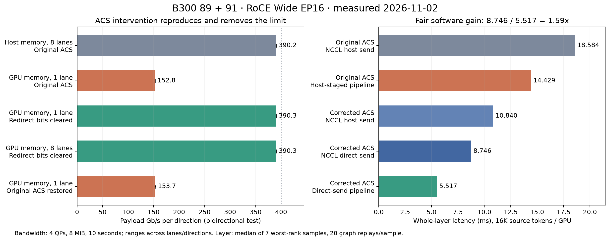

# Hierarchical MegaMoE archive validation

This is a development archive, not a production acceptance report. The base
is vLLM main `62c9b6263cea4a31444e597ebde1b1fe64dbe208` (2026-11-02).
The old RDMA MegaMoE implementation was not cherry-picked. The tokenizer
cache provenance and deployment carryovers are documented in the
[serving guide](hierarchical_mega_moe.md).

## Verbs pipeline: two-host single-layer validation

The 2026-11-02 follow-up adds a two-host RC-verbs/GPUDirect DMA-BUF backend,
CUDA stream memory handshakes, per-transfer epochs and receive credits,
independent double buffers for input and BF16 return, and a bounded CPU proxy
watchdog. It is selected explicitly with
`hierarchical_mega_moe_transport="verbs"`. NCCL remains the default.

The pipeline spans native MegaMoE calls on source-token chunks. It does not
modify DeepGEMM's internal GEMM-tile scheduler or grid barriers. The acceptance
harness compares matched serial/pipelined verbs, checks changing payloads and
graph inputs, and records CUDA and proxy timelines. See the
[commands and protocol](hierarchical_mega_moe.md#experimental-verbs-pipeline).

After the machines became available, validation ran on hosts 89 and 91,
each with eight B300 GPUs and eight selected 400-Gb/s RoCE ports. C++ JIT
compilation, DMA-BUF registration, exact changing-payload transfers, uneven
eager batches including an empty rank, tail padding, changed graph inputs,
all-masked routes and cross-host physical expert relocation passed. The
serial/pipeline comparison uses `rtol=0, atol=0`; the independent quantized
oracle retains `rtol=0.08, atol=0.01`. This is synthetic single-layer validation,
not whole-model accuracy or serving throughput.

The initial 15-case sweep covered 768/1536/4096/8192/16384 source tokens/GPU
and 512/1024/2048 source rows/tile. Adding 256-row tiles exposed a reproducible
16K-token eager-warmup deadlock. A Python stack dump located the host inside
the CUDA stream wait enqueue while the transport mutex was held. Enqueue
backpressure prevented the proxy from completing the network work needed to
drain the GPU stream; the same mutex also prevented watchdog progress.
Moving CUDA enqueue calls outside that mutex fixed the failing case. The
16K-token 256/512-row cases then passed exact checks and 1000 stress replays
per mode, followed by seven samples of 20 timed replays. NCCL also passed
1000 replays under the same timing harness. Earlier failed runs are not
performance or acceptance results.

This locking rule follows the CUDA driver's documented
[API synchronization behavior](https://docs.nvidia.com/cuda/archive/12.4.0/cuda-driver-api/api-sync-behavior.html):
an enqueue API may block on internal resource availability. The separate
relaxed-ordering optimization preserves completion visibility and relies on
receive credits to prevent overlapping writes to the same slot; see
[`ibv_reg_mr`](https://www.man7.org/linux/man-pages/man3/ibv_reg_mr.3.html).

### Controlled network checks

Before testing, the serving workers, CPU cache/store processes and router
were stopped on the four reserved hosts, and filesystem caches were dropped.
The selected ports were active at 400 Gb/s with RoCEv2 GID index 3. Each
test recorded before/after RDMA and Ethernet hardware counters.

Two receiving endpoints differed from the other selected ports: host 89
`mlx5_12` and host 91 `mlx5_18` used PCP trust with PFC disabled. The initial
successful sweep added 14,470 and 13,218 receive discards respectively;
opposite endpoints also recorded sequence errors and adaptive retransmissions.
These are counter increments during the test, not historical totals.

A temporary A/B configuration used DSCP trust and PFC priority 3 on those
two ports, matching the other ports. Their receive-buffer mapping adjusted
automatically. Subsequent completed runs had zero new receive discards,
sequence errors or adaptive retransmissions across all 16 selected ports.
However, the 16K-token, 512-row, four-QP median stayed approximately
17.4 ms. Eliminating the observed drops did not materially improve that
median; it does not establish tail-latency behavior. The configuration follows
the adapter's documented [QoS controls](https://networking-docs.nvidia.com/mlnxofedswum/23101190lts/quality-of-service-qos).

### Interpreting the speedup

The measurements in this subsection used the original PCIe ACS configuration.
The independent link tests below subsequently identified a platform routing
bottleneck. Do not use these numbers as the limit of a correctly configured
400-Gb/s GPUDirect path.

All latency summaries first take the maximum rank for each sample and then
the median of those samples. Tokens are **per GPU per step**; 16K on EP16
means 262,144 global source tokens, not 16K concurrent requests.

In the four-QP run with ordinary MR ordering, 16K tokens gave:

| Path | Source rows/tile | Latency (ms) |
| --- | --- | --- |
| Full-batch NCCL | 16384 | 18.599 |
| Serial verbs | 256 | 31.577 |
| Pipelined verbs | 256 | 20.692 |
| Serial verbs | 512 | 24.708 |
| Pipelined verbs | 512 | 17.434 |

The 256-row pipeline is 1.53x faster than **its own tiled serial control**,
but slower than the full-batch NCCL baseline. The 512-row pipeline is 1.42x
faster than its serial control and only 1.07x faster than NCCL. A matched
tiling speedup must not be presented as a speedup over the original path.

The separate stage profile at 16K measured approximately 5.25 ms dispatch,
3.01 ms native kernel time and 10.07 ms return, within an 18.82-ms layer.
If other costs remain unchanged, hiding the 3-ms compute component alone
gives roughly 1.19x. Ignoring pack/reduce and all remaining overhead as well
gives an optimistic 18.82/(5.25+10.07), or 1.23x. These are conditional
estimates, not hardware limits. Exceeding them requires reducing communication service
time or bytes, or changing the workload's compute/communication balance.

An isolated four-QP transport test measured 5.657 ms dispatch, 11.382 ms
BF16 return and 19.480 ms when submitting both together at 16K tokens. Each
GPU sends 87,293,952 dispatch bytes and 167,772,160 return bytes to its peer.
The return's approximately 118 Gb/s is **application payload throughput**, not
the Ethernet wire rate: the measurement includes self-copy, handshakes and
proxy progress. Concurrent dispatch and return share NIC and PCIe resources;
their durations cannot simply be replaced by their maximum.

CUDA traces show native kernels overlapping proxy transfer intervals, but
native kernel duration includes NVLink synchronization, and proxy intervals
include queueing and CPU completion polling. Neither is a direct measure of
Tensor Core utilization or NIC hardware service time. Chunking also increases
native invocation count and can reduce GEMM efficiency. The layer timing,
not visual overlap alone, determines the net benefit.

### PCIe routing diagnosis

Independent `ib_write_bw` tests on the same 89/91 pair excluded vLLM,
MegaMoE, the custom proxy and CUDA graph scheduling. Each selected lane used
four QPs, 8-MiB messages, a 10-second duration, GID 3 and traffic class 106.
CPU affinity and host-memory NUMA placement matched its GPU/NIC. Eight
lane processes ran concurrently; their measurement windows were independent,
so the table reports per-lane throughput rather than a synchronized fabric sum.
Bidirectional values are **per direction**, not the sum of transmit and receive.

| Independent transport | Median Gb/s | Range across lanes/directions |
| --- | --- | --- |
| Host memory, bidirectional | 390.25 | 390.22–390.27 |
| NIC reads GPU, remote host receive, unidirectional | 248.63 | 248.61–248.66 |
| NIC reads host, remote GPU receive, unidirectional | 349.84 | 347.50–350.05 |
| GPU to GPU, unidirectional | 248.65 | 248.60–248.67 |
| GPU to GPU, bidirectional | 152.60 | 151.51–157.07 |

One lane alone gave 390.27 Gb/s/direction for host memory and
152.85 Gb/s/direction for GPU memory. The limitation therefore did not
require eight lanes competing on the network, and it reproduced without
any MoE implementation code.

Full PCI configuration reads showed Gen6 x16 GPU/NIC switch links, a Gen5
x16 CPU uplink, 512-byte maximum payload and 4096-byte maximum read request.
The relevant switch ports had ACS control `0x1d`: both P2P Request Redirect
and P2P Completion Redirect were enabled. This can send peer transactions
through the CPU root complex, as described in NVIDIA's
[NCCL troubleshooting guide](https://docs.nvidia.com/deeplearning/nccl/archives/nccl_2297/user-guide/docs/troubleshooting.html#pci-access-control-services-acs).
The topology alone was not sufficient evidence; a controlled intervention
tested that explanation.

On each host, the first A/B changed only GPU0/NIC0's switch ports
`0000:17:00.0`, `0000:17:02.0` and `0000:1a:00.0` from `0x1d` to `0x11`,
clearing the two redirect bits while preserving the other control bits.
The same bidirectional GPU test rose to **390.27/390.29 Gb/s**, a 2.55x
increase. Original register words were saved, the diagnostic had a bounded
automatic restore, and restoration was read back successfully on both hosts.
No BIOS, IOMMU, firmware, NIC line rate or benchmark code changed in this A/B.
This identifies ACS routing as the principal cause of the measured GPU
transport limitation on these machines; it is not evidence of a slow 400G
network or defective PCIe hardware.

The host-staging option was also validated under the original ACS routing:
all 20 token/tile combinations passed exact serial/pipeline comparisons and
1000 stress replays per mode. At 16K tokens, the best observed 1024-row
pipeline took 14.429 ms versus 18.584 ms for full-batch NCCL, or 1.29x.
It is a useful workaround for a constrained GPU send path, not a substitute
for correcting the platform routing. Its independent copy stream also avoids
serializing DtoH copies with later native compute.

### Results with local PCIe peer routing

The same redirect-only change was then applied temporarily to the three
relevant switch ports on each of the eight GPU/NIC lanes per host. GPU
bidirectional throughput reached 390.23–390.30 Gb/s per direction across all
eight lanes. No new receive discards, sequence errors or adaptive
retransmissions appeared. On lane0, the original GPU bidirectional test
generated 28,156/27,516 transmitted priority-3 pause frames on the two hosts;
the corrected eight-lane test generated zero on that lane.

With those platform settings and the corrected NIC QoS, the final source
passed all 20 direct-send token/tile cases, each with 1000 serial and 1000
pipeline graph replays plus seven samples of 20 timed replays. NCCL was
remeasured with both `NCCL_NET_GDR_READ=0` and `1`; direct GPU sends were
faster and are the comparison baseline below. All 16 ranks contributed to
each worst-rank sample. No tested case loosened the correctness tolerances.

| Source tokens/GPU | NCCL, GDR read=0 (ms) | NCCL, GDR read=1 (ms) | Serial verbs, tile 2048 (ms) | Pipeline, tile 2048 (ms) | Speedup vs faster NCCL |
| --- | --- | --- | --- | --- | --- |
| 768 | 0.737 | 0.667 | 0.506 | 0.510 | 1.31x |
| 1536 | 1.186 | 1.026 | 0.872 | 0.872 | 1.18x |
| 4096 | 2.868 | 2.335 | 2.253 | 1.570 | 1.49x |
| 8192 | 5.565 | 4.445 | 4.497 | 2.895 | 1.54x |
| 16384 | 10.840 | 8.746 | 8.986 | 5.517 | **1.59x** |

The table keeps one 2048-row setting rather than choosing a different tile
for every row. At 1536 tokens, tile 512 was faster (0.798 ms). At 16K, tile
1024 was close (5.600 ms), while 512 and 256 increased latency to 6.838 and
12.135 ms. Small tiles add native invocations and synchronization overhead.
For batches no larger than one tile, this comparison mostly measures the
transport implementation; there is no later compute tile to overlap.

At 16K, a rank-0 traced replay contained 2.931 ms of native kernel intervals,
of which 2.774 ms overlapped proxy transfer intervals (94.6%). The proxy's
interval union was 5.272 ms. These are interval overlaps, not Tensor Core
utilization measurements; native intervals include NVLink waits and proxy
intervals include completion polling. The independently measured whole-layer
latency is the evidence for the 1.59x speedup.

The remaining limit is now predominantly payload serialization. One GPU
sends 255,066,112 bytes per layer: 87,293,952 dispatch and 167,772,160 BF16
return bytes. At 400 Gb/s the ideal serialization floor is 5.101 ms; at the
measured approximately 390.26-Gb/s payload capacity it is 5.229 ms. A
5.517-ms layer is only about 0.29 ms above that latter bound. Further large
gains require fewer bytes, more network bandwidth, or a different partition;
simply increasing overlap has much less room left on this workload.

The original-configuration NCCL latency of 18.584 ms versus the final
5.517 ms is a 3.37x total change, but includes the platform correction.
The software pipeline's fair comparison on the corrected platform is
**8.746/5.517 = 1.59x**, or 1.63x against matched serial verbs.

All 48 modified switch control words were restored and read back. Repeating
the single-lane GPU bidirectional test after restoration returned to
153.15/154.24 Gb/s, completing the A/B/A check. The performance numbers above
require the corrected platform configuration; the vLLM backend does not
modify ACS, BIOS or host networking automatically. Platform administrators
must establish the intended PCIe routing before deployment, considering the
machine's device-isolation requirements.

The two temporary QoS changes were also restored, including receive-buffer
sizes and priority-to-buffer mapping; the final QoS output matched the saved
original exactly. Test containers were stopped, filesystem caches dropped,
and all 32 GPUs on hosts 89/91/92/93 reported 0 MiB used and 0% utilization.
Previously stopped serving services were not restarted.

## Archived baseline checks (913d3c421)

- CPU/Gloo: 10 cases cover one to four logical islands, noncontiguous ranks,
  unequal and empty batches, source/receive chunking, masks and physical
  expert moves. Command:
  `.venv/bin/python -m pytest --noconftest tests/distributed/test_hierarchical_mega_moe.py -q`.
- Native tokenizer cache: three real BPE tokenizer tests passed, covering
  concurrent reuse, salts, epoch reset, fallback and eviction.
- B300: 92 kernel/module tests passed with `--noconftest`, including eight
  exact native MXFP8 staging cases (H=256/5120; T=7/65/936/1025).
  The remaining 31 tests required `dist_init`, absent with that invocation;
  they were not counted as passes. Retrying from an isolated tests copy
  collected all 123 but still did not load the top-level fixture; a complete
  repository test environment is needed for those 31 cases.
- Two B300 hosts, eight GPUs each: synthetic Wide EP16 ran at 768, 936,
  1024, 1536 and 4096 source tokens/GPU. Every case checked an independent
  dense oracle, changed graph inputs, masks, and cross-host physical expert
  relocation. Each timing followed 1000 CUDA graph replays, then 100 timed
  iterations; reported latency is the maximum across ranks.
- The standalone GPUNetIO C++ probe and pinned MSCCL++ dependency compiled
  with CUDA 13.0.88. Device-QP setup failed; no transport performance claim
  follows from that build.

The GPU environment used current-main Python sources over the existing
`e0d00e4b8eb0` image's native libraries, PyTorch 2.14.0+cu130 and NCCL
2.31.2. The relevant MegaMoE native API matched; this is not a clean build
of every native extension from the new main revision.

## Single-layer timing

Milliseconds, synthetic MXFP4 weights, E=384, H=5120, intermediate=2304,
top-k=6, fast math disabled. The local reference is two independent EP8
groups, each holding the full expert set. Whole-model behavior is not
measured here.

| Source tokens/GPU | Reconstruct BF16 | Direct MXFP8 | Tile 256 | Tile 512 | Tile 1024 | Independent EP8 |
| --- | --- | --- | --- | --- | --- | --- |
| 768 | 1.102 | 1.089 | 1.449 | 1.244 | 1.041 | 0.225 |
| 936 | 1.262 | 1.267 | 1.818 | 1.438 | 1.258 | 0.250 |
| 1024 | 1.350 | 1.346 | 1.891 | 1.501 | 1.342 | 0.258 |
| 1536 | 1.890 | 1.882 | 2.782 | 2.199 | 2.068 | 0.323 |
| 4096 | 4.850 | 4.798 | 7.240 | 5.656 | 5.138 | 0.741 |

Direct staging removes redundant conversions but gives only a small change
in total latency, including variation in either direction. Small ordered
tiles are slower here, so the default sends the full padded batch.
These data do not establish performance parity with NVL72 or an improvement
over the previous implementation under a controlled paired comparison.

## Historical failed NCCL overlap experiment and pending work

A two-stream, double-buffer prototype completed a 16-token source-tile
smoke case but timed out at 32 tokens, including with four NCCL CTAs.
DeepGEMM rejects reducing the SM count for MegaMoE because its locality
scheduler requires the full GPU. The unsafe prototype and unsupported SM
reservation knob were removed from the serving backend.

Subsequent diagnostic profiling covered larger per-step token counts and
confirmed the NCCL baseline's serial dispatch/compute/return ordering. The
separate verbs validation above supersedes the earlier lack of single-layer
overlap evidence. Compute must be remeasured
for each batch and tile size; the earlier 0.78 ms measurement is not a constant
for high concurrency. Distinguish concurrent requests from scheduler-limited
tokens per step.

Pending acceptance includes: complete native-extension build, real model
startup and accuracy, source EPLB load-accounting integration under serving,
draft warmup regression, sustained high-concurrency serving, and the prior
HTTP/long-generation timeout regressions. GPUNetIO setup and per-GEMM-tile
RDMA integration inside the persistent native kernel remain research work.
This branch must not be treated as having passed whole-model checks.

Changed-file pre-commit checks passed. A full-repository pre-commit run on
macOS still failed in unchanged main sources: checkpoint-related mypy
attributes, POSIX advice attributes in `qwen4_exp`, and the non-root
entrypoint test's `/var` versus `/private/var` working-directory expectation.
Those failures were not suppressed or counted as passes.
